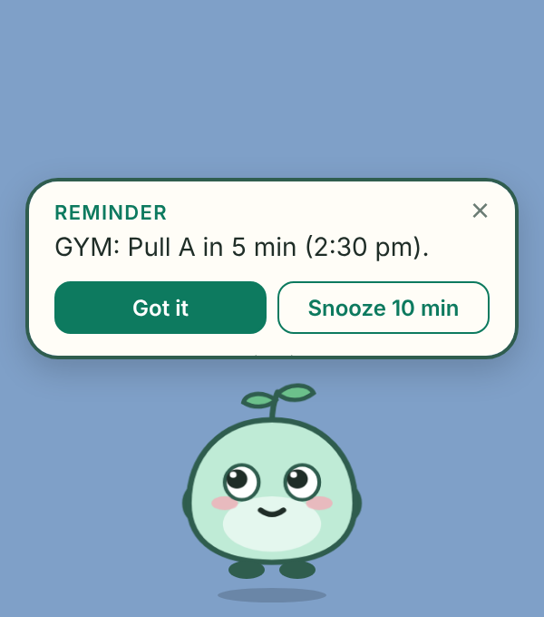
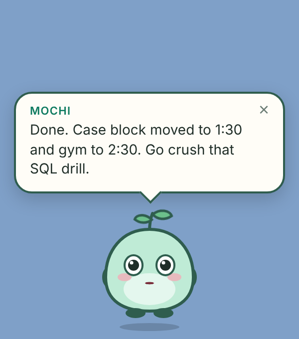

# Desk Buddy 🌱

A small walking buddy that lives at the bottom of your Mac screen. It reminds you about everything on your Google Calendar and nags you to drink water. Click it and say "push my case block to 1:30 and gym to 2:30", and Claude rearranges your calendar for you.

| Walking | Reminder | Talking | Asleep after 22:30 |
|---|---|---|---|
|  |  |  |  |

## What it does

- **Walks** along the top of your Dock, stops now and then, and turns around at the screen edges. Its eyes follow your cursor. You can drag it sideways.
- **Calendar reminders.** It hops and shows a speech bubble 5 minutes before every event and again when the event starts. It also reads the reminder aloud and sends a macOS notification. You can tap "Got it" or "Snooze 10 min".
- **Water reminders** every 60 minutes while you're awake.
- **Click to talk.** It listens through your mic, transcribes on your Mac with whisper.cpp, and sends your request to Claude. Claude reads and edits your Google Calendar with tools, then answers in the bubble and out loud.
- **Right-click** for a menu: type instead of talking, stay in place, sign in to Google, open settings, open the Daily OS board, or quit. The same menu sits in the menu bar under 🌱.
- **Sleeps** between 22:30 and 07:00. It stops walking and skips water reminders so it doesn't nag you at night.

## Setup (about 15 minutes, one time)

You need macOS, [Node.js 20+](https://nodejs.org) and [Homebrew](https://brew.sh).

### 1. Install

```bash
git clone https://github.com/<you>/desk-buddy.git
cd desk-buddy
npm install
npm run setup:voice      # installs whisper.cpp + a 140 MB English model (on-device, free)
```

### 2. Anthropic API key

1. Create a key at <https://console.anthropic.com> → API Keys, and add a few dollars of credit.
2. Run `npm start` once. It creates `~/Library/Application Support/desk-buddy/config.json`.
3. Right-click the buddy → **Settings**, then paste the key into `"anthropicApiKey"`. Settings reload automatically.

You can also run `ANTHROPIC_API_KEY=sk-ant-... npm start` instead.

### 3. Google Calendar access

1. Go to <https://console.cloud.google.com>, create a project, and enable the **Google Calendar API**.
2. Open **APIs & Services → OAuth consent screen**. Choose **External**, fill in the app name, and under **Test users** add the Google account whose calendar you want the buddy to see.
3. Open **Credentials → Create credentials → OAuth client ID**, choose application type **Desktop app**, and download the JSON.
4. Save that file as `~/Library/Application Support/desk-buddy/google-credentials.json`. Right-click the buddy → **Open settings folder** takes you there.
5. Right-click the buddy → **Sign in to Google…**, then approve in the browser.

> While the consent screen is in "Testing" mode, Google expires the sign-in after 7 days. Click **Publish app** on the consent screen (you can skip verification for personal use) so it stays signed in.
> If your calendar belongs to a work or school Google Workspace, the admin may block apps they haven't approved. If sign-in fails with "access blocked", that's why.

### 4. Allow the microphone

The first time you click the buddy, macOS asks for microphone access. Allow it. If you said no, go to System Settings → Privacy & Security → Microphone.

## Things to say

- "I slept in, start my day at 12:30 and keep lights out at 10:30."
- "Move gym to 2:30 today."
- "From now on, breakfast is 8 to 8:30 every day."
- "What's next?" / "What does tomorrow look like?"
- "Add a 30-minute SQL revision block at 6 pm tomorrow."

It asks you to confirm before deleting anything, or before changing more than 8 events at once.

## Settings (`config.json`)

| Key | Default | What it does |
|---|---|---|
| `name` | `Mochi` | Buddy's name |
| `model` | `claude-sonnet-5-5` | Claude model used for conversations |
| `timeZone` | `Asia/Kolkata` | Time zone for reading and writing events |
| `reminderLeadMinutes` | `5` | How early the "coming up" reminder fires |
| `water` | `{ enabled: true, everyMinutes: 60 }` | Water reminder |
| `awake` | `{ from: "07:00", to: "22:30" }` | Outside these hours it sleeps |
| `speak` / `voice` | `true` / `Samantha` | Read replies aloud (`say -v '?'` lists voices) |
| `walkSpeed` | `1.2` | Pixels per frame |
| `whisperBin` / `whisperModel` | auto | Override the speech-to-text paths |

## Build a real app (optional)

```bash
npm run dist     # creates dist/Desk Buddy-<version>.dmg
```

To start it at login, drag the app into **System Settings → General → Login Items**.

## How it's built

- `main.js`: Electron main process. Runs a transparent, always-on-top, click-through window and the walking loop, polls the calendar every 5 minutes, checks reminders every 30 seconds, and has the right-click and menu-bar menus.
- `src/agent.js`: the Claude tool-use loop. `src/tools.js`: the calendar tools Claude can call (list, create, update one, update a whole series, delete).
- `src/calendar.js`: Google Calendar using a loopback OAuth flow. Tokens stay on your Mac with `chmod 600`.
- `src/speech.js`: whisper.cpp for listening, macOS `say` for talking.
- `renderer/`: the character (inline SVG with CSS animations), speech bubble, and mic recorder.
- `npm test` covers the time-zone math, reminder timing, the agent loop and the WAV encoding.

## Privacy

Your voice is transcribed on your Mac. Only the transcribed text and your calendar data go to Anthropic's API, and only when you talk to the buddy. Keys and tokens live in `~/Library/Application Support/desk-buddy/` and are git-ignored.

## Roadmap

- Phone companion (PWA) that shares reminders
- Daily OS board check-ins (tick boxes by voice)
- More characters and outfits
